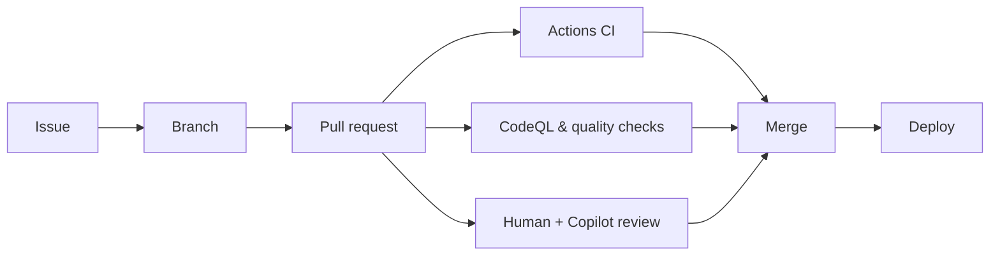

# GitHub: Build, Secure & Accelerate

Platform overview · CodeQL · Code quality · Security tab · Copilot · Universe 2026

<div class="pt-8 opacity-80">November 12, 2026 · 60 minutes</div>

<!--
Welcome everyone. Set expectations: this is an introductory session, half slides and half live in the platform.
Ask: "Quick show of hands — who uses GitHub daily? Who has seen a code scanning alert?" Use the answers to calibrate depth.
Time check: 0:00.
-->

---
layout: default
---

# Agenda

| Time | Topic | Format |
| --- | --- | --- |
| 0:00 | Welcome | Slides |
| 0:03 | GitHub overview | Slides + 🖥️ live |
| 0:11 | CodeQL | Slides + 🖥️ live |
| 0:21 | Code quality | Slides + 🖥️ live |
| 0:28 | Security tab | 🖥️ live |
| 0:36 | GitHub Copilot | Slides + 🖥️ live |
| 0:48 | GitHub Universe 2026 highlights | Slides |
| 0:55 | Questions & discussion | Open floor |

<div class="mt-6 text-sm opacity-70">🖥️ = we switch from slides to github.com</div>

<!--
Point out the 🖥️ markers: those are where we leave the deck and go to the platform.
Mention that the deck and every demo script live in the training repository, so attendees can revisit afterwards.
-->

---
layout: section
---

# 1 · GitHub overview

The platform where code, collaboration, automation, and security meet

<!--
Transition: "Before we get into security and AI, let's ground ourselves in what GitHub actually is today."
-->

---

# One platform for the whole software lifecycle

<div class="grid grid-cols-3 gap-6 mt-6">
<div>

### Plan
- Issues & sub-issues
- Projects (boards, tables, roadmaps)
- Discussions

</div>
<div>

### Build
- Repositories & branches
- Pull requests & code review
- Codespaces
- GitHub Copilot

</div>
<div>

### Ship & secure
- GitHub Actions (CI/CD)
- Packages & Pages
- Code scanning, secret scanning, Dependabot

</div>
</div>

<div class="mt-8 p-4 bg-blue-500/10 rounded">
💡 <b>Key idea:</b> everything is connected — an issue links to a PR, the PR runs Actions and security checks, and merging closes the issue.
</div>

<!--
Talking points:
- GitHub started as Git hosting; today it covers plan → build → ship → secure.
- The value is the connections: the same pull request carries code review, CI results, security findings, and Copilot suggestions.
- Keep it high-level — we'll go deeper on security and Copilot.
-->

---

# The pull request is the center of gravity



- Branch protection / rulesets decide **what must pass** before merge
- Security and quality findings show up **in the PR**, before code ships

<!--
Talking points:
- Everything we see today converges on the pull request.
- Rulesets let admins require reviews, status checks, and code scanning results before merging.
- This is "shift left": find problems in the PR, not in production.
-->

---
layout: center
class: text-center
---

# 🖥️ Live: Tour the repository

`guide/01-github-overview.md`

Code · Issues · Pull requests · Actions · Projects · Security · Insights

<!--
SWITCH TO BROWSER. Follow guide/01-github-overview.md (about 5 minutes).
1. Open the training repository Code tab — point out README rendering, branches, and the .github folder.
2. Issues → open an issue, show labels/assignees and the "Create a branch" link.
3. Pull requests → show a PR's Conversation, Checks, and Files changed tabs.
4. Actions → show the "Deploy slides to GitHub Pages" run that published THIS deck.
5. Mention Settings → Rules for branch protection.
Return to the deck.
-->

---
layout: section
---

# 2 · CodeQL

Semantic code analysis that treats code as data

<!--
Transition: "Now that we know where code lives, how do we find vulnerabilities in it automatically?"
-->

---

# What is CodeQL?

<div class="grid grid-cols-2 gap-8">
<div>

- The engine behind **GitHub code scanning**
- Builds a **database** from your code, then runs **queries** over it
- Tracks **data flow**: from untrusted *sources* (user input) to dangerous *sinks* (SQL, file system, HTML)
- Supports C/C++, C#, Go, Java/Kotlin, JavaScript/TypeScript, Python, Ruby, Swift, Rust, GitHub Actions
- Results appear as **alerts** in the Security tab and **annotations** in PRs

</div>
<div>

```js
// demo-app/src/server.js
app.get('/users', (req, res) => {
  const name = req.query.name;       // 🔴 source
  const sql =
    `SELECT * FROM users WHERE name = '${name}'`;
  db.all(sql, ...);                  // 🔴 sink
});
```

CodeQL flags this as **SQL injection** (`js/sql-injection`) because user input flows unsanitized into a query.

</div>
</div>

<!--
Talking points:
- Analogy: CodeQL turns your code into a database, and vulnerabilities become queries.
- The source → sink idea is the most important concept for beginners.
- Point at the code: req.query.name is user-controlled; it ends up concatenated into SQL.
-->

---

# Two ways to turn it on

<div class="grid grid-cols-2 gap-8 mt-4">
<div class="p-4 rounded bg-green-500/10">

### Default setup
- Settings → Code security → **CodeQL analysis → Set up → Default**
- GitHub picks languages & queries
- Runs on push, PR, and weekly
- ✅ Best starting point

</div>
<div class="p-4 rounded bg-purple-500/10">

### Advanced setup
- Commit a workflow (`.github/workflows/codeql.yml`)
- Choose query suites (`security-extended`, `security-and-quality`)
- Custom build steps, custom queries
- ✅ When you need control

</div>
</div>

<div class="mt-6">

**Copilot Autofix** proposes a fix for many alerts — review it, then commit it to a branch or PR.

</div>

<!--
Talking points:
- Most teams should start with default setup — it's a few clicks and needs no YAML.
- Advanced setup is in this repo at .github/workflows/codeql.yml so people can see what it looks like.
- Copilot Autofix: explains the alert and suggests a patch. A human still reviews it.
- Licensing note: public repos get code scanning free; private/internal repos need GitHub Code Security.
-->

---
layout: center
class: text-center
---

# 🖥️ Live: Find & fix a SQL injection

`guide/02-codeql.md`

<!--
SWITCH TO BROWSER (demo repository with code scanning enabled). About 6 minutes.
1. Show the CodeQL workflow run in Actions.
2. Security → Code scanning → open the "Database query built from user-controlled sources" alert.
3. Walk the data-flow path ("Show paths") from req.query.name to db.query.
4. Click "Generate fix" (Copilot Autofix) and read the explanation aloud.
5. Optional: open the prepared PR that introduces a new vulnerability and show the inline annotation.
-->

---
layout: section
---

# 3 · Code quality

Reliability and maintainability, not just security

<!--
Transition: "Not every problem is a vulnerability. Some code is just hard to maintain or likely to break."
-->

---

# Why code quality matters

<div class="grid grid-cols-2 gap-8">
<div>

### GitHub Code Quality
- Uses CodeQL **quality queries** to find reliability & maintainability issues
- Scores repositories on **Reliability** and **Maintainability**
- Shows findings on pull requests and in the repository's **Code quality** view
- **Copilot Autofix** suggests fixes; assign the backlog to Copilot coding agent

</div>
<div>

### Typical findings
- Unused variables & imports
- Duplicate / dead code
- Comparisons that are always true/false
- Overly complex functions
- Missing `await`, swallowed errors

```js
function applyDiscount(total, code) {
  let unused = 42;              // ⚠️ unused
  if (code == code) { ... }     // ⚠️ self-comparison
}
```

</div>
</div>

<!--
Talking points:
- Security scanning asks "can this be exploited?"; quality asks "will this break or slow the team down?"
- Findings land in the same PR experience, so developers fix them before merge.
- Example code lives in demo-app/src/utils/pricing.js and demo-app/python/report.py.
- Quality gates can be enforced with rulesets (e.g., block merges below a threshold).
-->

---
layout: center
class: text-center
---

# 🖥️ Live: Code quality findings

`guide/03-code-quality.md`

<!--
SWITCH TO BROWSER. About 4 minutes.
1. Open the Code quality view for the demo repository (Security & quality → Code quality).
2. Show the Reliability / Maintainability ratings.
3. Open the finding in pricing.js (self-comparison or unused variable).
4. Show the suggested fix and how you'd hand it to Copilot.
If Code Quality isn't enabled, show the same findings via the CodeQL "security-and-quality" suite results.
-->

---
layout: section
---

# 4 · The Security tab

One place to see and act on risk

<!--
Transition: "We've seen individual alerts. Let's look at the home for all of them."
-->

---

# What lives in the Security tab

<div class="grid grid-cols-2 gap-6">
<div>

| Feature | What it finds |
| --- | --- |
| **Code scanning** | Vulnerabilities in your code (CodeQL, AI Scan, 3rd-party SARIF) |
| **Secret scanning** | Committed tokens, keys, passwords |
| **Push protection** | Blocks secrets *before* they land |
| **Dependabot** | Vulnerable dependencies + update PRs |
| **Security policy & advisories** | How to report & publish fixes |

</div>
<div>

### Org & enterprise view
- **Security overview**: risk & coverage across all repos
- **Security campaigns**: fix a backlog at scale with Copilot Autofix
- **Rulesets** to require scanning results before merge

</div>
</div>

<!--
Talking points:
- Repository Security tab = one repo. Security overview = every repo in your org.
- Push protection is the only control here that PREVENTS rather than detects — emphasize it.
- Dependabot: demo-app/package.json pins old lodash/express versions on purpose to generate alerts.
-->

---
layout: center
class: text-center
---

# 🖥️ Live: Security tab walkthrough

`guide/04-security-tab.md`

<!--
SWITCH TO BROWSER. About 6 minutes.
1. Security tab overview → show enabled features.
2. Dependabot → open the lodash alert, show severity, affected versions, and the security update PR.
3. Secret scanning → explain alerts; optionally demo push protection with a TEST token from docs.
4. Code scanning → filter by severity and branch.
5. (If org access) Security overview → coverage and risk dashboards.
-->

---
layout: section
---

# 5 · GitHub Copilot

Your AI pair programmer — and increasingly, your AI teammate

<!--
Transition: "We've found problems. Now let's see how AI helps us write better code and fix problems faster."
-->

---

# Copilot across the workflow

<div class="grid grid-cols-2 gap-6">
<div>

### In the editor
- **Code completions** as you type
- **Copilot Chat**: ask, explain, refactor, write tests
- **Agent mode**: multi-file changes from a prompt

### On github.com & beyond
- **Copilot coding agent**: assign an issue → get a PR
- **Copilot code review**: AI review on pull requests
- **Copilot CLI** and the **GitHub Copilot app**

</div>
<div>

### Make it yours
- `.github/copilot-instructions.md` — repo-wide guidance
- `.github/prompts/*.prompt.md` — reusable prompts
- Model choice & MCP connectors

<div class="mt-4 p-3 rounded bg-yellow-500/10 text-sm">
👩‍💻 You stay in control: Copilot proposes, humans review and merge.
</div>

</div>
</div>

<!--
Talking points:
- Start with completions & chat — the lowest-friction value.
- Coding agent and code review move Copilot from "assistant" to "teammate" that works asynchronously.
- Custom instructions are the #1 tip for better results; show this repo's .github/copilot-instructions.md.
-->

---
layout: center
class: text-center
---

# 🖥️ Live: Copilot in action

`guide/05-github-copilot.md`

Explain → Fix → Test → Assign → Review

<!--
SWITCH TO EDITOR / BROWSER. About 8 minutes.
1. Open demo-app/src/server.js in VS Code or Codespaces; ask Copilot Chat "/explain" on the /users route.
2. Ask: "Fix the SQL injection using parameterized queries." Accept the diff.
3. Ask Copilot to write a unit test for applyDiscount in pricing.js.
4. On github.com, assign the prepared issue to Copilot coding agent; show the PR it opens (prepare one in advance).
5. Request a Copilot code review on a PR and show comments.
-->

---
layout: section
---

# 6 · GitHub Universe 2026 highlights

Announced October 28, 2026

<!--
Transition: "Let's zoom out to what GitHub announced at Universe a couple of weeks ago."
Source: github.blog "GitHub Universe 2026: Evolving every layer of the stack" and github.com/events/universe/recap.
-->

---

# Copilot: from assistant to agent platform

<div class="grid grid-cols-2 gap-6 text-sm">
<div>

- **GitHub Copilot app** — issue to merge in one agent-first app
- **Copilot Fusion** — choose Standard / High / Max effort; Copilot picks and combines models
- **Copilot projects** — give Copilot a goal; parallel sessions across repos
- **Session continuity** — one cloud session across app, VS Code, CLI, web

</div>
<div>

- **Copilot automations** — scheduled or event-driven AI workflows that learn from outcomes
- **Copilot code review Max** — deeper review tier for high-risk changes
- **Copilot connectors** — authenticate once to tools like Vercel, Cloudflare, Sentry
- **Copilot included with GitHub Enterprise** — pay for the AI credits you use

</div>
</div>

<!--
Talking points:
- Theme of Universe: "completed work, not more code."
- Fusion: you pick effort; GitHub picks the models. Balances quality, speed, and cost.
- Enterprise licensing change is a big deal for budgeting: no separate Copilot subscription for GitHub Enterprise customers (via Sales now, self-serve coming).
-->

---

# Platform & security announcements

<div class="grid grid-cols-2 gap-6 text-sm">
<div>

### Platform
- **Stacked pull requests** — break large work into linked PRs, merge the stack in one click
- **Issue artifacts** — keep plans & research attached to the issue
- **`gh --attach`** — add images/video from the CLI
- **Infrastructure** — multi-region Azure migration & new Git architecture for agent-scale traffic

</div>
<div>

### Security
- **AI Scan** — scan a whole repo on demand, incl. languages CodeQL doesn't cover
- **AI-powered push protection** — catches unstructured secrets like passwords
- **Package firewall** — blocks malicious npm packages before install
- **Reachability analysis** — prioritize Dependabot alerts your code actually calls
- **Security canvas** in the Copilot app — explain & fix findings

</div>
</div>

<!--
Talking points:
- Tie back to earlier sections: AI Scan complements CodeQL; reachability makes the Security tab's Dependabot list shorter and more relevant; AI push protection extends secret scanning.
- Octoverse 2026 report also launched — octoverse.github.com.
-->

---
layout: center
class: text-center
---

# Questions & discussion

<div class="mt-6 text-left inline-block">

- What would you turn on first: CodeQL default setup, push protection, or Dependabot?
- Where could Copilot coding agent take work off your team's plate?
- Which Universe announcement is most relevant to you?

</div>

<div class="mt-8 text-sm opacity-70">
Slides & demo scripts: the <code>nov12-training</code> repository
</div>

<!--
Use the prompts if the room is quiet. Capture follow-ups in an issue in the training repo.
Close on time at 1:00.
-->

---
layout: end
---

# Thank you!
